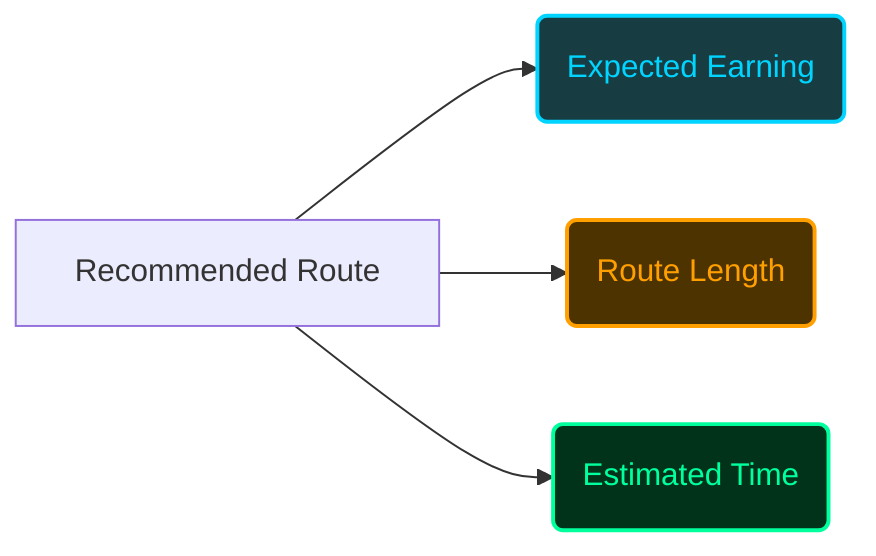
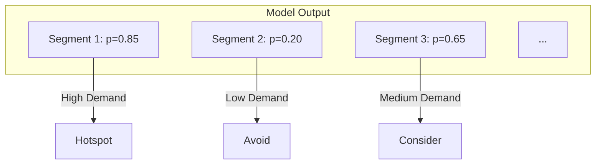
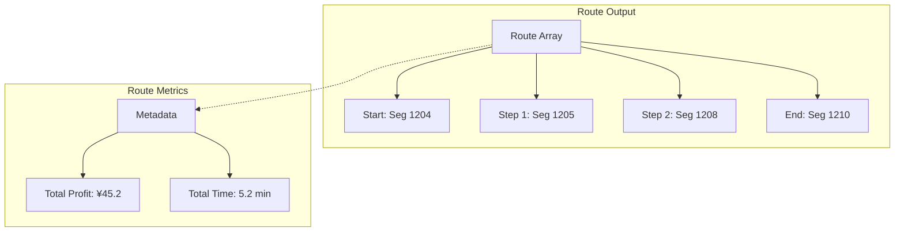

# Output Explanation: Taxi Route Recommender System

This document explains the outputs generated by the Taxi Route Recommender system, including both the web application and the underlying algorithms.

## Web Application Outputs

When a user requests a route recommendation via the web application, the system provides several key metrics and visualizations.

### 1. Route Visualization

The primary output is the visual representation of the recommended route on the Beijing road network map.

| Component | Description | Visual Representation |
| :--- | :--- | :--- |
| **Start Point** | The initial location of the taxi, set by the user clicking on the map. | 🚕 Taxi Icon |
| **Route** | The sequence of road segments forming the optimal path. | Colored Polyline (e.g., solid cyan line) |
| **End Point** | The final destination of the recommended route. | Colored Circle Marker |
| **Heatmap** | (Optional Overlay) Areas with high probability of finding a passenger. | Gradient (Blue to Red/White) |

### 2. Result Metrics

The dashboard displays quantitative metrics for the recommended route(s).

| Metric | Description | Example |
| :--- | :--- | :--- |
| **Expected Earning** | The projected revenue for the trip based on historical data and the Bellman equation calculation. | `¥48.85` |
| **Route Length** | The number of distinct road segments the taxi needs to traverse. | `9 segments` |
| **Estimated Time** | The approximate driving time to complete the route. | `4.0 minutes` |
| **Taxis Recommended** | The number of taxis for which routes were computed (1 for RRS, >1 for SRRS). | `1` |

---

## Algorithmic Outputs

The core algorithms (GCN-LSTM and RRS/SRRS) generate specific mathematical outputs that drive the system.

### 1. GCN-LSTM Predictions

The deep learning model outputs a probability score for each road segment.

*   **Pickup Probability ($p$):** A value between 0 and 1 indicating the likelihood of a passenger requesting a ride on that segment at the given time.

### 2. RRS/SRRS Optimization Results

The routing algorithms output the optimal sequence of segments.

*   **Route Array:** An ordered list of segment IDs representing the path.
*   **Total Expected Profit:** The maximized value $G^*(r)$ computed by the algorithm.
*   **Total Travel Time:** The sum of the travel times for each segment in the route.

## Experiment Results (Model Stats)

The system also tracks the performance of the GCN-LSTM model across different hyperparameter configurations.

| Metric | Description | Note |
| :--- | :--- | :--- |
| **MAE (Mean Absolute Error)** | The average difference between the predicted pickup probabilities and the actual observed probabilities. | Lower is better. |
| **Best MAE** | The lowest MAE achieved across all experiment runs. | e.g., `0.05935` |
| **Hyperparameters** | The configuration used for a specific run (e.g., GCN dims, LSTM dims, Learning Rate, Prior Days). | e.g., `[18, 18]`, `[10]` |
