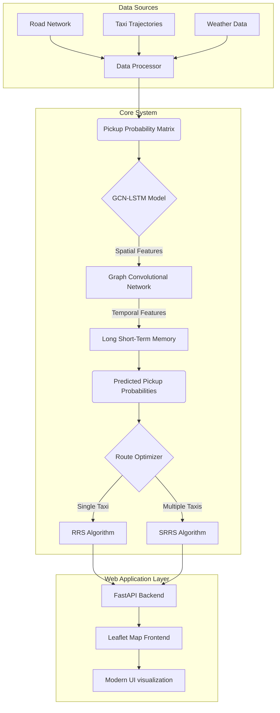
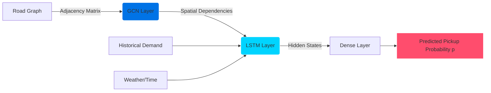
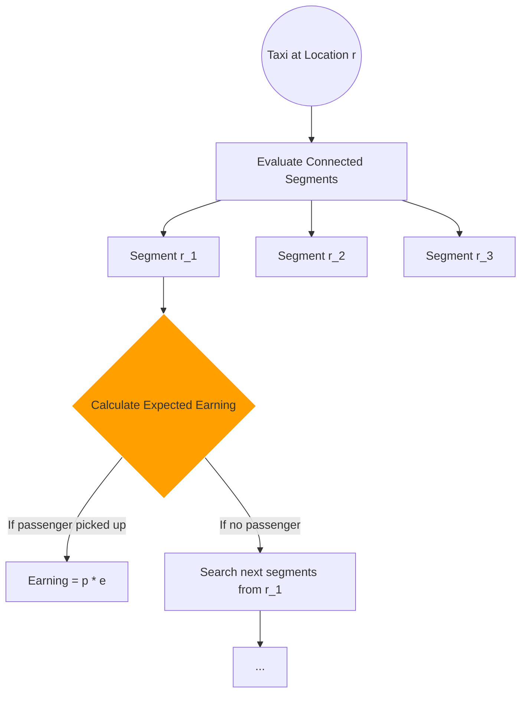
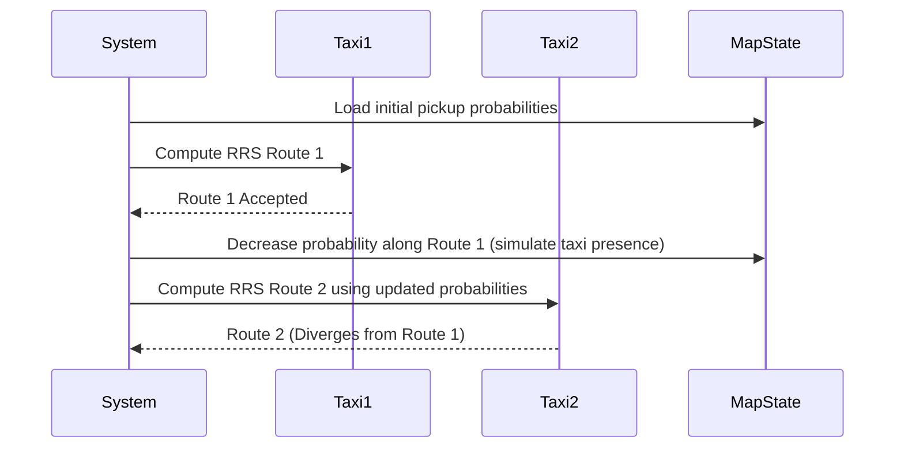

# Project Explanation: Taxi Route Recommender System

Based on the paper: **"A Cost-Effective Sequential Route Recommender System for Taxi Drivers"** (INFORMS Journal on Computing, 2023) by Liu, Teng, Chen, and Xiong.

This project provides real-time sequential route recommendations for vacant taxi drivers. It uses a hybrid deep learning model (GCN-LSTM) to predict passenger demand and a recursive search algorithm to find the most profitable routes.

## System Architecture

The system consists of four main components working together:

1.  **Data Processing:** Ingests raw road network data, GPS trajectories, and weather data.
2.  **GCN-LSTM Predictor:** A deep learning model that predicts the probability of finding a passenger on any given road segment.
3.  **Route Optimizer (RRS/SRRS):** The recommendation engine that computes the optimal path based on expected earnings and driving time.
4.  **Web Application (FastAPI & Leaflet):** A modern, interactive web interface for visualizing predictions and real-time route recommendations on a map.

## Detailed Component Flow

### 1. The Prediction Model (GCN-LSTM)

The model needs to understand both *where* passengers are (spatial) and *when* they need rides (temporal).

*   **GCN (Graph Convolutional Network):** Captures the spatial relationships between connected road segments in the Beijing road network. If a neighboring street has high demand, the GCN helps the model understand that this street might also see increased demand soon.
*   **LSTM (Long Short-Term Memory):** Captures the temporal patterns (e.g., morning rush hour vs. late night) from historical data sequences.

### 2. The Route Optimizer (RRS & SRRS)

Once we know the pickup probabilities ($p$), we need to find the route that maximizes expected earnings ($e$) within a given time limit ($\tau$).

#### RRS (Recursive Route Searching)

For a single taxi, the system uses the Bellman equation to recursively evaluate potential future paths.

*Formula:* $G^*(r) = p \cdot e + (1-p) \cdot \max_{r'} G^*(r')$
(The expected earning is the probability of a pickup $\times$ the earning, plus the probability of NO pickup $\times$ the best possible earning from the next segment).

#### SRRS (Sequential Recursive Route Searching)

If multiple taxis are nearby, recommending the exact same "best" route to all of them causes congestion and reduces their chances of finding a passenger. SRRS solves this by dynamically updating the "supply" state.

By sequentially updating the probabilities after each recommendation, SRRS ensures fair distribution of taxis across hotspots.

### 3. The Interactive Web Application

To make the academic algorithms accessible, we built a modern web application:

*   **Backend (FastAPI):** Serves the model predictions and route calculations via high-performance REST APIs (`/api/recommend`, `/api/hotspots`).
*   **Frontend (Vanilla JS + Mapbox GL JS):** A dynamic, flat SaaS-style interface featuring hardware-accelerated vector mapping, native WebGL heatmaps, animated route polylines, and Geocoding address search.
*   **Mapbox Integration & Security:** The application renders interactive maps using Mapbox GL JS. To prevent API key leaks, the `MAPBOX_ACCESS_TOKEN` is securely stored in a `.env` file on the server. The FastAPI backend reads this file via `python-dotenv` and dynamically injects the token into the frontend map initialization, ensuring the repository remains secure when pushed to GitHub.
